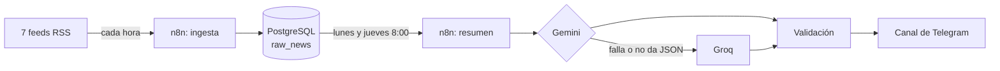

# Noticiero IA

Un bot que lee siete blogs y feeds sobre inteligencia artificial, se queda con lo publicado en la última semana y, dos veces por semana (lunes y jueves a las 8:00), manda a un canal de Telegram un resumen corto en español: tres noticias destacadas con qué ha pasado y qué le puede suponer a un negocio, y el resto en una línea con su enlace para quien quiera comprobarlo.

Canal en vivo: [t.me/ia_al_grano](https://t.me/ia_al_grano) («IA al grano»; también se lee sin cuenta de Telegram en [t.me/s/ia_al_grano](https://t.me/s/ia_al_grano)).

## Cómo funciona

Un feed RSS es el formato en el que un blog publica sus novedades para que otros programas las lean; n8n es la herramienta que encadena los pasos (leer, guardar, pedir el resumen, comprobarlo, enviarlo) y PostgreSQL es la base de datos donde se guarda lo leído.

- **Ingesta** (`workflows/ingesta.json`, cada hora): lee los feeds y guarda hasta 15 noticias por fuente de los últimos 7 días; una noticia que ya está no se repite y un feed caído no detiene a los demás.
- **Resumen** (`workflows/resumen.json`): toma lo publicado en los últimos 4 días, quita titulares repetidos y deja como mucho 6 por fuente; la IA elige y redacta, se comprueba lo que ha escrito, se guarda y se envía.

## Decisiones que importan

| Decisión | Para qué |
|---|---|
| La IA solo elige y redacta; el enlace, la fuente y la fecha salen de la base de datos a partir del número de la noticia | Así no puede inventarse un enlace ni atribuir una noticia a otra fuente |
| Si el texto escrito por la IA trae una cifra que no estaba en la noticia original, esa noticia se descarta y el motivo queda anotado en la tabla `digests` | Un resumen con un dato inventado es peor que uno más corto |
| El «por qué importa» va en forma impersonal y solo con lo que se deduce del texto | Para que no prometa resultados que la noticia no dice |
| Dos modelos: Gemini y, si falla o no devuelve un JSON válido, Groq | La capa gratuita de Gemini a veces responde «alta demanda»; con la reserva el resumen sale igual y el pie del mensaje dice quién lo escribió |
| El resumen sale en un único mensaje de 4000 caracteres como máximo | Telegram corta a los 4096; si no cabe todo, se recorta la parte de «También» |
| Solo entra lo que trae fecha de publicación válida (últimos 7 días) y texto que resumir (al menos 80 caracteres) | Sin fecha no se puede saber si es actual, y sin texto la IA no tiene de dónde resumir |
| La URL es única en la tabla (`ON CONFLICT DO NOTHING`) | Ejecutar la ingesta las veces que haga falta no duplica nada |
| Máximo 6 noticias por fuente en el resumen | Que un blog que publica mucho no acapare el mensaje |
| Las claves viven en credenciales cifradas de n8n y en un `.env` que no se sube | Los JSON de los workflows se pueden publicar sin riesgo; se comprobó buscando en los archivos y en todo el historial |

## Arrancarlo en local

Hace falta Docker con Docker Compose (Docker empaqueta cada programa con lo que necesita para que funcione igual en cualquier equipo).

1. `cp .env.example .env` y rellenar las cuatro variables: contraseña de PostgreSQL, clave de Gemini, clave de Groq y token del bot de Telegram.
2. `docker compose up -d`
3. `bash scripts/importar.sh`: guarda las claves como credenciales cifradas dentro de n8n e importa los dos workflows.
4. Abrir `http://localhost:5679`, crear la cuenta local de n8n y, en el workflow del resumen, cambiar `canal` en el nodo «Configuración» (viene con `@ia_al_grano`) por el `@nombre` de un canal tuyo donde el bot sea administrador con permiso para publicar.
5. Ejecutar a mano la ingesta y después el resumen; para dejarlo programado, publicar los dos workflows.

Terminado cuando llega al canal un único mensaje con noticias de los últimos cuatro días y todos sus enlaces abren.

## Límites conocidos

- Gemini devuelve a veces «alta demanda»; en ese caso redacta `openai/gpt-oss-120b` en Groq, y el modelo usado se puede cambiar en el nodo «Configuración».
- Solo entran feeds que traen texto, así que algunas fuentes populares (Reddit, Hacker News) no están: Reddit bloquea la lectura automática y Hacker News solo da el titular.
- La validación comprueba cifras y enlaces, no el sentido de cada frase: un resumen puede quedarse corto o simplificar, y por eso cada noticia lleva su enlace a la fuente.
- Está pensado para un equipo local; para que corra cada lunes y jueves sin depender de un ordenador encendido hace falta un servidor con Docker, y el mismo `docker-compose.yml` sirve.

Con lo que hay se podría seguir de varias maneras: leer el artículo entero antes de resumirlo y no solo el titular, y luego avisar con un mensaje privado cuando algún paso falle, y más adelante usar la misma base de noticias para otro canal u otro tema, cambiando solo las fuentes y las instrucciones al modelo.

## Tecnologías

n8n 2.13 y Docker Compose; PostgreSQL 16; API de Gemini, API de Groq y API de bots de Telegram.

## Licencia

MIT; el texto completo está en [LICENSE](LICENSE).
